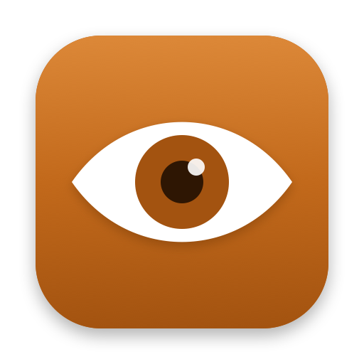

<p align="center"></p>

<h1 align="center">bAwake</h1>

<p align="center">
  See why your Mac won't sleep, and keep it awake while your AI agents and builds work.<br>
  A free macOS menu bar app by <a href="https://www.bernisoftware.com.br">Berni Software</a>.
</p>

<p align="center">
  <a href="https://github.com/bernisoftware/bawake/releases/latest"><b>Download</b></a> ·
  <a href="https://bernisoftware.github.io/bawake/">Website</a> ·
  <a href="https://github.com/bernisoftware/bawake/issues">Report a problem</a>
</p>

## What it does

- **Inspector**: every process keeping your Mac awake right now, with the reason it gave.
- **Agents and builds**: detects Claude Code, Codex, Gemini CLI, Aider, xcodebuild, swift build,
  docker build, npm/pnpm/yarn and cargo; stays awake until they finish and tells you when they
  need you.
- **Sleep history**: each night's timeline, and what kept the Mac up.
- **Sessions**: 15 min, 1 h, 4 h or until off, with the equivalent `caffeinate` command.
- **Rules**: stay awake on your Wi-Fi networks, on the power adapter, with an external display,
  or during a Focus.
- **Shortcuts and Siri**, **lid closed** mode, **battery and temperature safety**.
- **`bawake` command line tool** included.
- 38 languages, light and dark appearance, Apple silicon and Intel, macOS 14 Sonoma or later.
  Signed and notarized by Apple; updates itself.

## Install

Download the DMG from [Releases](https://github.com/bernisoftware/bawake/releases/latest) and drag
bAwake to Applications, or use Homebrew:

```sh
brew install --cask bernisoftware/tap/bawake
```

```sh
bawake -- npm run build       # awake while the command runs
bawake --for 2h               # for two hours
bawake status                 # what is keeping the Mac awake now
```

## Feedback

Bug reports, ideas and translation fixes are very welcome in
[Issues](https://github.com/bernisoftware/bawake/issues).

## About

bAwake is made by [Berni Software](https://www.bernisoftware.com.br), a software company from
Porto Alegre, Brazil, building apps, systems and IT solutions since 2013. We made it for the way
we work with AI agents every day, and share it free with the community. If it helps you, a star
here or a follow on [Instagram](https://instagram.com/berni.software) means a lot.

bAwake is free to use. See [LICENSE](LICENSE.md). © 2026 Berni Software LTDA.
